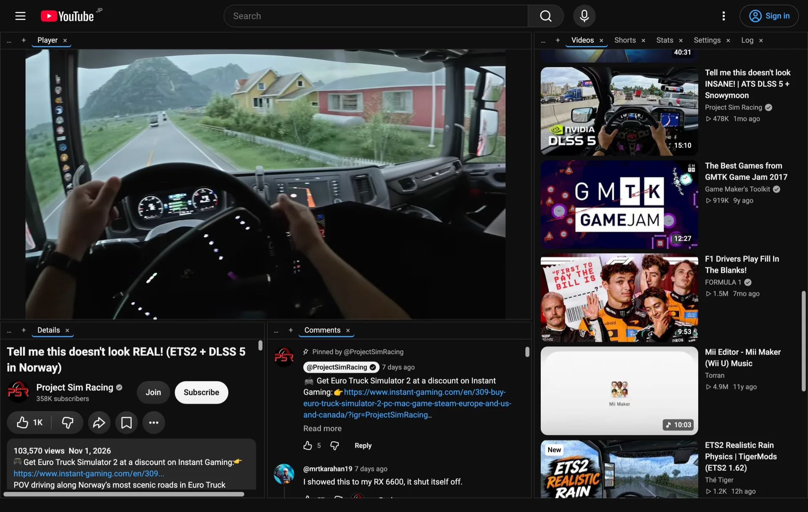

# ytenrich

A browser extension that makes YouTube more personal and more comfortable to use: recommendation statistics, hiding of recommendations that keep reappearing without being opened, one-click "Not interested", and a tiling window manager layout on every YouTube page.



## Features
- **Tiling everywhere**: every page, Shorts included, is a tiling layout, and each pane scrolls on its own.
  - Watch pages: the player sits above Details | Comments side by side, with recommendations on the right, all in resizable panes.
  - Home, search, channels, playlists and feeds: the guide sits on the left and the page itself is a tab next to Stats/Settings/Log.
  - Watch pages and the other pages each keep their own saved layout.
  - Drag a tab to a pane edge to split that pane, onto a pane to join its tabs, or between tabs of a strip to reorder.
  - The ☰ button toggles YouTube's guide (sidebar) as a tile on the left instead of an overlay drawer.
  - On watch pages, Chat sits next to Comments, and the Shorts shelf of the recommendations can become its own tile (pane `+` menu → Shorts).
  - The Shorts player page is a tile too, with a **Recommended** tile beside it: videos YouTube recommended recently that you have not opened yet (from ytenrich's own stats).
  - Stats, History, Recommended, Settings and Log open as tabs inside the panes. Settings can reset the layout.
  - `Alt+W` turns tiling off and on.
- **Recommendation stats**: each recommendation counts as seen once it is at least half visible, at most once per page view. The Stats view updates live; clicking a video opens it in the same tab.
- **Hide over-exposed videos**: videos recommended N times that you never opened are hidden or dimmed. You choose N.
- **One-click "Not interested"**: an always-visible ⊘ button right next to every recommendation's ⋮ menu. On success the item collapses at once; on failure ⊘ turns red and its tooltip (and the Log) lists the menu entries YouTube offered.

Stats are enabled only after you agree on the welcome page (or later in Stats or Settings). It stays on this device, never reaches the developer, and builds your stats and the repeated-recommendation filter. Thumbnail images in the Stats, History and Recommended views are a separate opt-in (Chromium only). See the [privacy policy](PRIVACY.md).

## Install (from source)
```sh
pnpm install && pnpm build
```
- Chromium: open `chrome://extensions`, turn on Developer mode, click "Load unpacked" and select `dist/`.
- Firefox (desktop 140+): run `pnpm build --firefox`, open `about:debugging`, choose "Load Temporary Add-on" and select `dist-firefox/manifest.json`. Grant access to youtube.com if prompted.

## Release
- Bump `version` in `package.json`, commit, then run `pnpm package`. It writes `release/ytenrich-<version>-{chromium,firefox,source}.zip`.
- `pnpm store-assets` writes the listing images to `release/store/`.
- Listing text, dashboard answers and per-store steps are in [docs/store.md](docs/store.md).

## Screenshots
| | |
|-|-|
|  | Watch page tiling (dark): player, details, comments, recommendations |

## Development
AI-first repository: start at [AGENTS.md](AGENTS.md).

### Firefox reviewer build

Use Node.js 24.15.0 and pnpm 11.1.2. From the root of the source archive:

```sh
npx --yes pnpm@11.1.2 install --frozen-lockfile
npx --yes pnpm@11.1.2 build --firefox
```

The extension files are in `dist-firefox/`, with `manifest.json` at the package root.

## License
[Apache-2.0](LICENSE)

ytenrich is not affiliated with, endorsed by or sponsored by YouTube or Google.
