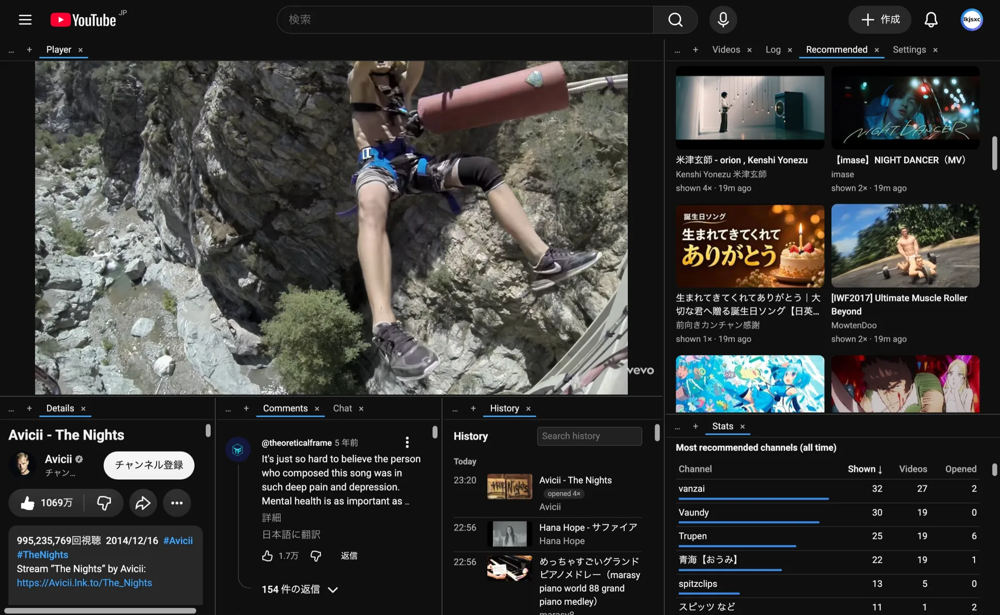

# ytenrich

A browser extension that makes YouTube more personal and more comfortable to use: recommendation statistics, hiding of recommendations that keep reappearing without being opened, one-click "Not interested", and a tiling window manager layout on every YouTube page.

**Install:** [Chrome Web Store](https://chromewebstore.google.com/detail/ytenrich/ikcbajmfmiobffnnimnhojlbpieegijc) · [Edge Add-ons](https://microsoftedge.microsoft.com/addons/detail/ytenrich/hnlgfllmbcccenikhnmbfakopidlmkfc) · [Firefox Add-ons](https://addons.mozilla.org/firefox/addon/ytenrich/)



## Features
- **Tiling everywhere**: every page, Shorts included, is a tiling layout, and each pane scrolls on its own.
  - Watch pages: the player sits above Details | Comments side by side, with recommendations on the right, all in resizable panes.
  - Home, search, channels, playlists and feeds: the guide sits on the left and the page itself is a tab next to Stats/Settings/Log.
  - Watch pages and the other pages each keep their own saved layout.
  - Drag a tab to a pane edge to split that pane, onto a pane to join its tabs, or between tabs of a strip to reorder.
  - The ☰ button toggles YouTube's guide (sidebar) as a tile on the left instead of an overlay drawer.
  - On watch pages, Chat sits next to Comments, and the Shorts shelf of the recommendations can become its own tile (pane `+` menu → Shorts).
  - The Shorts player page is a tile too, with a **Recommended** tile beside it: videos YouTube recommended recently that you have not opened yet (from ytenrich's own stats).
  - Stats, History, Settings, Log and the recommended Videos, Shorts and Channels lists open as tabs inside the panes (YouTube's own lists are the "Default · …" tabs). Closing a tab takes three clicks on × by default, so a slip does not lose it. Settings can reset the layout.
  - `Alt+W` turns tiling off and on.
- **Recommendation stats**: each recommendation counts as seen once it is at least half visible, at most once per page view. The Stats view updates live; clicking a video opens it in the same tab.
- **Recommended**: ytenrich's own list of what YouTube recommended and you have not opened, ranked by what you actually open: the channels you return to, the title words of videos you open against those you pass over or dismiss, freshness, and how persistently YouTube offers it. It collects every recommendation YouTube puts on a page, including lists your layout hides, and lets those hidden lists load more until it holds enough (Settings → Collect for Recommended).
- **Hide over-exposed videos** (off by default): a video YouTube keeps showing over more than a day that you never open can be hidden or dimmed. You choose how many impressions it takes; channels you open get three times the patience, and a video YouTube stops pushing is forgiven.
- **One-click "Not interested"**: an always-visible ⊘ button right next to every recommendation's ⋮ menu. On success the item collapses at once; on failure ⊘ turns red and its tooltip (and the Log) lists the menu entries YouTube offered.

Stats are on from the start; the welcome page that opens after installing says what is recorded and can turn them off, as can Settings. The record stays on this device, never reaches the developer, and builds your stats and the repeated-recommendation filter. Thumbnail images in the Stats, History and Recommended views are on by default and can be turned off in Settings (Chromium only; the Firefox build has none). See the [privacy policy](PRIVACY.md).

## Install
The stores are the easy way, because they update on their own:
- [Chrome Web Store](https://chromewebstore.google.com/detail/ytenrich/ikcbajmfmiobffnnimnhojlbpieegijc): Chrome, Brave, Vivaldi and other Chromium browsers.
- [Edge Add-ons](https://microsoftedge.microsoft.com/addons/detail/ytenrich/hnlgfllmbcccenikhnmbfakopidlmkfc): Microsoft Edge.
- [Firefox Add-ons](https://addons.mozilla.org/firefox/addon/ytenrich/): Firefox desktop 140 or newer.

### From GitHub (no store)
The newest release is always at these links:
- Chromium browsers: [ytenrich-chromium.zip](https://github.com/lkjsxc/ytenrich/releases/latest/download/ytenrich-chromium.zip)
- Firefox: [ytenrich-firefox.zip](https://github.com/lkjsxc/ytenrich/releases/latest/download/ytenrich-firefox.zip)

To try the very newest code instead (built on every change, ahead of the releases and less tested), open the newest run of the [Build workflow](https://github.com/lkjsxc/ytenrich/actions/workflows/build.yml?query=branch%3Amain+is%3Asuccess) and download `ytenrich-chromium` or `ytenrich-firefox` under **Artifacts** (GitHub asks you to sign in for this). Each download is the extension itself as a zip.

Chrome, Edge, Brave, Vivaldi:
1. Download the Chromium zip and unzip it into a folder you will keep (for example `Documents/ytenrich`).
2. Open `chrome://extensions` and turn on **Developer mode** (top right).
3. Click **Load unpacked** and pick that folder.

To update, download the zip again, replace the folder's contents, and click the reload arrow on the ytenrich card in `chrome://extensions`. Settings, layouts and stats are kept as long as the folder stays in the same place. An install from GitHub does not update by itself; [watch releases](https://github.com/lkjsxc/ytenrich/releases) to hear about new ones. Settings → Export data moves your data between a GitHub install and a store install.

Firefox only installs unsigned add-ons temporarily: open `about:debugging#/runtime/this-firefox`, click **Load Temporary Add-on** and pick the downloaded zip. It is removed when Firefox closes, so use the [Firefox Add-ons listing](https://addons.mozilla.org/firefox/addon/ytenrich/) for everyday use.

All versions are on the [releases page](https://github.com/lkjsxc/ytenrich/releases).

### From source
```sh
pnpm install && pnpm build
```
- Chromium: open `chrome://extensions`, turn on Developer mode, click "Load unpacked" and select `dist/`.
- Firefox (desktop 140+): run `pnpm build --firefox`, open `about:debugging`, choose "Load Temporary Add-on" and select `dist-firefox/manifest.json`. Grant access to youtube.com if prompted.

## Release
- Bump `version` in `package.json`, commit, then run `pnpm package`. It writes `release/ytenrich-<version>-{chromium,firefox,source}.zip`.
- `pnpm store-assets` writes the listing images to `release/store/`.
- Listing text, dashboard answers and per-store steps are in [docs/store.md](docs/store.md).

## Development
AI-first repository: start at [AGENTS.md](AGENTS.md).

### Firefox reviewer build

Use Node.js 24.15.0 and pnpm 11.1.2. From the root of the source archive:

```sh
npx --yes pnpm@11.1.2 install --frozen-lockfile
npx --yes pnpm@11.1.2 build --firefox
```

The extension files are in `dist-firefox/`, with `manifest.json` at the package root.

## License
[Apache-2.0](LICENSE)

ytenrich is not affiliated with, endorsed by or sponsored by YouTube or Google.
